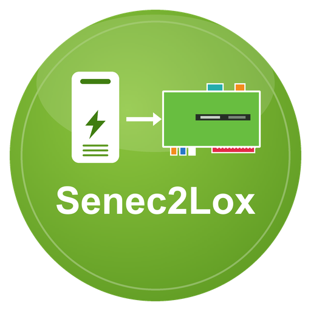

# Senec2Lox – LoxBerry-Plugin

**Version 1.4.1** · Benötigt PHP ≥ 8.2 · [Changelog](CHANGELOG.md)

Dokumentation: [docs/wiki/Home.md](docs/wiki/Home.md)

Liest einen SENEC-Stromspeicher aus (lokal `lala.cgi`, lokale OpenAPI :4424, SENEC.Connect-Cloud) und veröffentlicht die Werte
per MQTT am LoxBerry-Broker (→ MQTT-Gateway → Loxone). Details: [SENEC-LoxBerry-Plugin-Spezifikation.md](SENEC-LoxBerry-Plugin-Spezifikation.md).

## Installation
1. `bash build.sh` → `senec2lox-<version>.zip`
2. In LoxBerry → Plugin-Verwaltung → ZIP installieren.
3. Plugin öffnen, IP des Speichers eintragen, speichern. Werte erscheinen unter `senec/live/*`.

**Immer das neueste Release:** `https://github.com/ricten/Senec2Lox/releases/latest/download/senec2lox.zip` (ZIP ohne Version im Namen). **Automatische Updates:** Neue Installationen stehen in der Plugin-Verwaltung auf „Releases“, LoxBerry prüft täglich die `release.cfg` im Repository und installiert neuere Versionen selbst (Details: [docs/wiki/Installation.md](docs/wiki/Installation.md)).

## OpenAPI (optional)
Reiter „Einstellungen“ → Bereich „Lokale OpenAPI“: „Am Speicher registrieren“ → Freigabe im Portal unter `https://mein-senec.de/endkunde/#/0/senec-open-api`.
Registrierung erfolgt nur per Knopfdruck. Bei Deinstallation den Eintrag im Portal selbst entfernen.

## Entwicklung
- Tests: `php tests/run.php`
- Fake-Server: `php -S 127.0.0.1:8081 tests/fake_lala.php`, `php tests/fake_mqtt.php 18830`
- Dienst lokal: `SENEC2LOX_DEV_DIR=<verzeichnis mit senec2lox.json> php senec2lox/bin/senec2lox.php`

## Lizenz / Danksagung
`StateTexts.php` und die lala-Abfragelisten/Dekodierung basieren auf [ioBroker.senec](https://github.com/nobl/ioBroker.senec), MIT-Lizenz, © NoBl.
