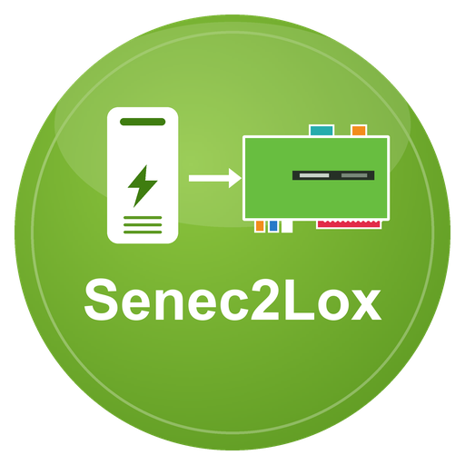

# Senec2Lox

**Senec2Lox** ist ein LoxBerry-Plugin, das Daten eines SENEC-Stromspeichers abfragt und an den MQTT-Broker des LoxBerry veröffentlicht.
Über das LoxBerry-MQTT-Gateway gelangen die Werte an den Loxone Miniserver.

## Was kann das Plugin?

- Drei Datenquellen, einzeln oder kombiniert: **lokal `lala.cgi`**, **lokale SENEC OpenAPI (Port 4424)**, **SENEC.Connect (Cloud)**
- „Sprechende“ Topics wie `senec/live/pv_w`, `senec/live/netz_w`, `senec/live/batterie_soc`
- Automatische Umschaltung auf die nächste Quelle, wenn die bevorzugte ausfällt
- Konfigurationsänderungen ohne Neustart, Autostart nach Reboot, Watchdog
- Nur **lesender** Zugriff auf den Speicher – keine Steuerung

## Welche Quelle für welches System?

| System | Empfehlung |
|---|---|
| SENEC V2 / V2.1 / V3 | lala.cgi (Hauptquelle), optional OpenAPI und/oder Connect |
| SENEC V4 / P4 / E4 | nur SENEC.Connect (kein lala.cgi, kein Port 4424) |

## Seiten

1. [Installation](Installation.md)
2. [Konfiguration](Konfiguration.md)
3. [Datenquellen](Datenquellen.md)
4. [OpenAPI-Registrierung](OpenAPI-Registrierung.md)
5. [MQTT-Topics](MQTT-Topics.md)
6. [Loxone-Anbindung](Loxone-Anbindung.md)
7. [Fehlersuche](Fehlersuche.md)
8. [Entwicklung](Entwicklung.md)

## Voraussetzungen

- LoxBerry ≥ 4.0 mit aktivem MQTT-Broker (Mosquitto)
- PHP ≥ 8.4 (CLI) mit `curl`- und `openssl`-Erweiterung
- SENEC-Speicher im selben Netz (für lala.cgi/OpenAPI) bzw. SENEC-Konto mit Subscription-Key (für Connect)

## Lizenz und Danksagung

Die Abfragelisten, die Dekodierung der `lala.cgi`-Werte und die Statustexte basieren auf
[ioBroker.senec](https://github.com/nobl/ioBroker.senec) (MIT-Lizenz, © NoBl).
SENEC ist eine Marke der SENEC GmbH; dieses Projekt ist inoffiziell und nicht von SENEC unterstützt.
